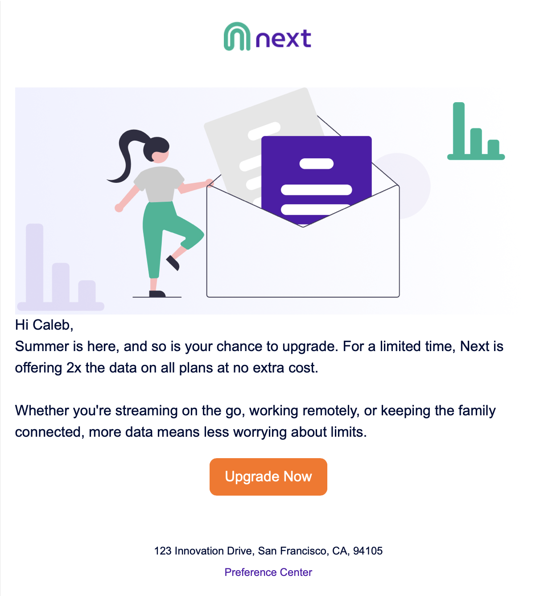

# Day 3 - Email Content Creation

🌐 English · Español · Français · 日本語 · Türkçe — expand a section

<b>English</b>

Build the summer campaign email with brand guidelines, Content Builder elements, and basic personalization.

## Contents
| File | Purpose |
|------|---------|
| `brand-spec.md` | Brand values (colors, fonts, logo) for setting up the brand in the CMS workspace. |
| `email-copy.md` | The campaign email copy to build in Content Builder. |
| `email-hero.png` | Hero image for the campaign email. |
| `next-logo.png` | The Next logo. |
| `email-final.png` | Preview of the finished email. |
| `email-sample.html` | Sample rendered email for reference. |

## Previews
| Email hero | Finished email | Logo |
|:---:|:---:|:---:|
|  |  |  |

## How to use
1. Set the brand from `brand-spec.md` and add `next-logo.png`.
2. Build the email with the copy in `email-copy.md` and `email-hero.png`.
3. Compare your result against `email-final.png` and `email-sample.html`.

---
New here? Start the 30-day Marketing Cloud challenges for free at marketingcloud30.com

<b>Español</b> — Día 3 - Creación de contenido de email

Crea el email de la campaña de verano con las directrices de marca, elementos de Content Builder y personalización básica.

## Contenido
| Archivo | Propósito |
|------|---------|
| `brand-spec.md` | Valores de marca (colores, fuentes, logo) para configurar la marca en el workspace de CMS. |
| `email-copy.md` | El texto del email de la campaña para construir en Content Builder. |
| `email-hero.png` | Imagen principal para el email de la campaña. |
| `next-logo.png` | El logo de Next. |
| `email-final.png` | Vista previa del email terminado. |
| `email-sample.html` | Email de muestra renderizado como referencia. |

## Vistas previas
| Imagen principal del email | Email terminado | Logo |
|:---:|:---:|:---:|
|  |  |  |

## Cómo usarlo
1. Configura la marca a partir de `brand-spec.md` y añade `next-logo.png`.
2. Construye el email con el texto de `email-copy.md` y `email-hero.png`.
3. Compara tu resultado con `email-final.png` y `email-sample.html`.

---
¿Eres nuevo aquí? Comienza los retos de 30 días de Marketing Cloud gratis en marketingcloud30.com

<b>Français</b> — Jour 3 - Création du contenu de l'email

Construisez l'email de la campagne d'été avec les directives de marque, les éléments de Content Builder et une personnalisation de base.

## Contenu
| Fichier | Objectif |
|------|---------|
| `brand-spec.md` | Valeurs de marque (couleurs, polices, logo) pour configurer la marque dans l'espace de travail CMS. |
| `email-copy.md` | Le texte de l'email de campagne à construire dans Content Builder. |
| `email-hero.png` | Image principale de l'email de campagne. |
| `next-logo.png` | Le logo Next. |
| `email-final.png` | Aperçu de l'email terminé. |
| `email-sample.html` | Exemple d'email rendu pour référence. |

## Aperçus
| Image principale | Email terminé | Logo |
|:---:|:---:|:---:|
|  |  |  |

## Comment l'utiliser
1. Définissez la marque à partir de `brand-spec.md` et ajoutez `next-logo.png`.
2. Construisez l'email avec le texte de `email-copy.md` et `email-hero.png`.
3. Comparez votre résultat à `email-final.png` et `email-sample.html`.

---
Nouveau ici ? Démarrez gratuitement les challenges Marketing Cloud de 30 jours sur marketingcloud30.com

<b>日本語</b> — Day 3 - メールコンテンツの作成

ブランドガイドライン、Content Builder の要素、基本的なパーソナライゼーションを使って、サマーキャンペーンのメールを構築します。

## 内容
| ファイル | 用途 |
|------|---------|
| `brand-spec.md` | CMS ワークスペースでブランドを設定するためのブランド値（色、フォント、ロゴ）。 |
| `email-copy.md` | Content Builder で構築するキャンペーンメールのコピー。 |
| `email-hero.png` | キャンペーンメールのヒーロー画像。 |
| `next-logo.png` | Next のロゴ。 |
| `email-final.png` | 完成したメールのプレビュー。 |
| `email-sample.html` | 参考用のサンプルレンダリング済みメール。 |

## プレビュー
| ヒーロー画像 | 完成したメール | ロゴ |
|:---:|:---:|:---:|
|  |  |  |

## 使い方
1. `brand-spec.md` からブランドを設定し、`next-logo.png` を追加します。
2. `email-copy.md` のコピーと `email-hero.png` を使ってメールを構築します。
3. できあがった結果を `email-final.png` と `email-sample.html` と見比べます。

---
はじめての方へ。30日間の Marketing Cloud チャレンジを marketingcloud30.com で無料で始めましょう。

<b>Türkçe</b> — Gün 3 - E-posta İçeriği Oluşturma

Yaz kampanyası e-postasını marka kuralları, Content Builder öğeleri ve temel kişiselleştirme ile oluştur.

## İçerik
| Dosya | Amaç |
|------|---------|
| `brand-spec.md` | Markayı CMS workspace'inde kurmak için marka değerleri (renkler, fontlar, logo). |
| `email-copy.md` | Content Builder'da oluşturulacak kampanya e-posta metni. |
| `email-hero.png` | Kampanya e-postası için hero görseli. |
| `next-logo.png` | Next logosu. |
| `email-final.png` | Tamamlanmış e-postanın önizlemesi. |
| `email-sample.html` | Referans için örnek render edilmiş e-posta. |

## Önizlemeler
| Hero görseli | Tamamlanmış e-posta | Logo |
|:---:|:---:|:---:|
|  |  |  |

## Nasıl kullanılır
1. Markayı `brand-spec.md` dosyasından ayarla ve `next-logo.png` görselini ekle.
2. E-postayı `email-copy.md` içindeki metin ve `email-hero.png` ile oluştur.
3. Sonucunu `email-final.png` ve `email-sample.html` ile karşılaştır.

---
Yeni misin? 30 günlük Marketing Cloud görevlerine ücretsiz olarak marketingcloud30.com adresinden başla.

