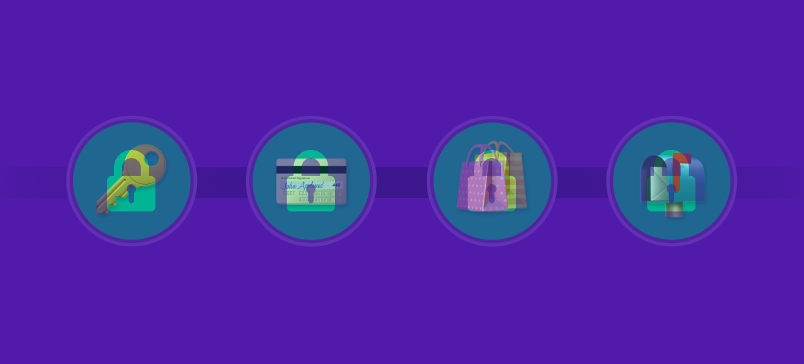
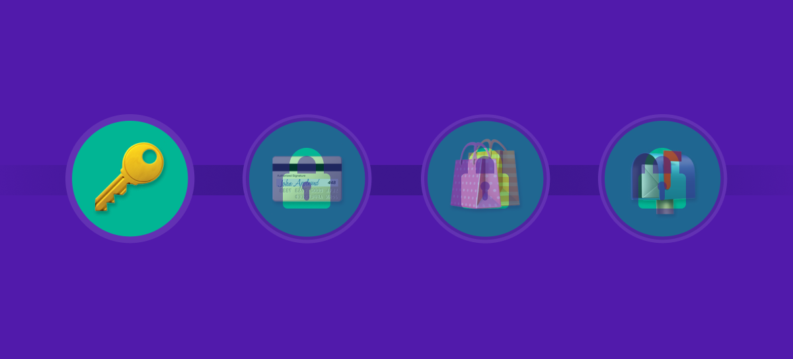
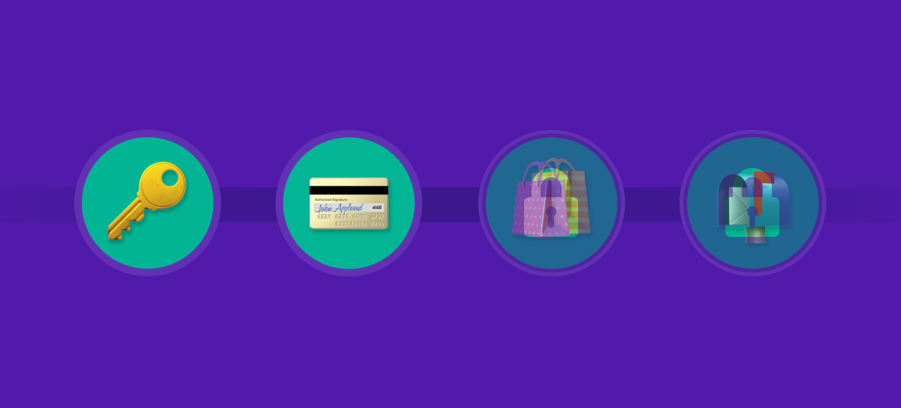
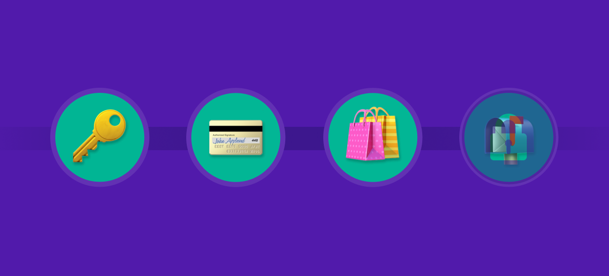
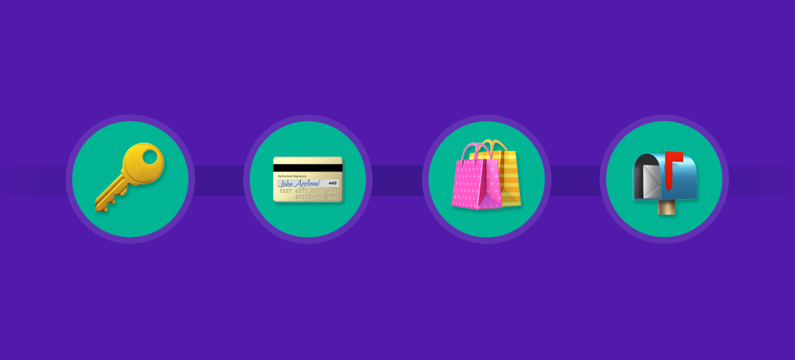

# Day 23 - Personalize an Email with Handlebars

🌐 English · Español · Français · 日本語 · Türkçe — expand a section

## Files
| File | Purpose |
|------|---------|
| `set-password.png, add-card.png, connect-rewards.png, update-prefs.png, all-set.png` | The five hero banners, one per setup step. |

| Set password | Add payment | Connect rewards | Update prefs | All set |
|:---:|:---:|:---:|:---:|:---:|
|  |  |  |  |  |

<b>English</b>

Read each customer's account-setup progress from a Marketing Object and swap the email's hero banner and body copy to match their next unfinished step.

**How to use:**
1. Upload the five banners to your org; note each image URL.
2. Clone the previous email, rename it "Account Setup Nudge".
3. Add an HTML component (banner) and a Paragraph component (body) following the challenge solution, swapping in your banner URLs.
4. Preview with a recipient from the AccountSetupProgress__mo Marketing Object.

Requires the AccountSetupProgress__mo Marketing Object from the previous challenge.

---
New here? Start the 30-day Marketing Cloud challenges for free at marketingcloud30.com

<b>Español</b> — Día 23 - Personalizar un email con Handlebars

Lee el progreso de configuración de la cuenta de cada cliente desde un Marketing Object y cambia el hero banner y el texto del email para que coincidan con su siguiente paso sin terminar.

**Cómo usar:**
1. Sube los cinco banners a tu org; anota la URL de cada imagen.
2. Clona el email anterior y renómbralo "Account Setup Nudge".
3. Añade un componente HTML (banner) y un componente Paragraph (cuerpo) siguiendo la solución del reto, cambiando por las URLs de tus banners.
4. Previsualiza con un destinatario del Marketing Object AccountSetupProgress__mo.

Requiere el Marketing Object AccountSetupProgress__mo del reto anterior.

---
¿Eres nuevo aquí? Comienza los retos de 30 días de Marketing Cloud gratis en marketingcloud30.com

<b>Français</b> — Jour 23 - Personnaliser un email avec Handlebars

Lisez la progression de configuration du compte de chaque client depuis un Marketing Object et changez le hero banner et le texte de l'email pour correspondre à leur prochaine étape inachevée.

**Comment utiliser :**
1. Téléversez les cinq banners dans votre org ; notez l'URL de chaque image.
2. Clonez l'email précédent et renommez-le "Account Setup Nudge".
3. Ajoutez un composant HTML (banner) et un composant Paragraph (corps) en suivant la solution du challenge, en remplaçant par les URLs de vos banners.
4. Prévisualisez avec un destinataire du Marketing Object AccountSetupProgress__mo.

Nécessite le Marketing Object AccountSetupProgress__mo du challenge précédent.

---
Nouveau ici ? Démarrez gratuitement les challenges Marketing Cloud de 30 jours sur marketingcloud30.com

<b>日本語</b> — Day 23 - Handlebars でメールをパーソナライズする

各顧客のアカウント設定の進捗を Marketing Object から読み取り、メールの hero banner と本文コピーを、次の未完了ステップに合わせて切り替えます。

**使い方:**
1. 5つの banner をご自身の組織にアップロードし、各画像の URL を控えます。
2. 前回のメールをクローンし、「Account Setup Nudge」に名前を変更します。
3. チャレンジのソリューションに沿って HTML コンポーネント（banner）と Paragraph コンポーネント（本文）を追加し、自分の banner の URL に差し替えます。
4. AccountSetupProgress__mo Marketing Object のレコードでプレビューします。

前回のチャレンジの AccountSetupProgress__mo Marketing Object が必要です。

---
はじめての方へ。30日間の Marketing Cloud チャレンジを marketingcloud30.com で無料で始めましょう。

<b>Türkçe</b> — Gün 23 - Handlebars ile Bir E-postayı Kişiselleştir

Her müşterinin hesap kurulum ilerlemesini bir Marketing Object'ten oku ve e-postanın hero banner'ını ve gövde metnini, bir sonraki tamamlanmamış adımına uyacak şekilde değiştir.

**Nasıl kullanılır:**
1. Beş banner'ı org'una yükle; her görselin URL'sini not al.
2. Önceki e-postayı klonla ve "Account Setup Nudge" olarak yeniden adlandır.
3. Görevin çözümünü izleyerek bir HTML bileşeni (banner) ve bir Paragraph bileşeni (gövde) ekle, kendi banner URL'lerinle değiştir.
4. AccountSetupProgress__mo Marketing Object'ten bir alıcıyla önizle.

Önceki görevdeki AccountSetupProgress__mo Marketing Object'i gerektirir.

---
Yeni misin? 30 günlük Marketing Cloud programlarına ücretsiz olarak marketingcloud30.com adresinden başla.

